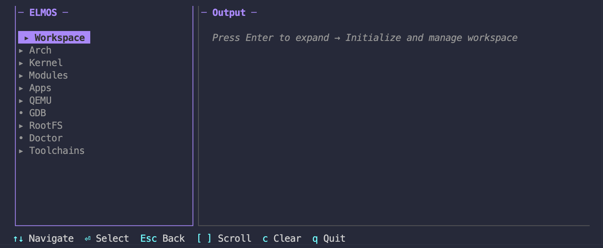

# ELMOS - Embedded Linux on macOS

[](https://codeberg.org/NguyenTrongPhuc552003/elmos) [](https://opensource.org/licenses/MIT) [](https://codeberg.org/NguyenTrongPhuc552003/elmos/src/branch/main/docs)

A complete embedded Linux SDK for macOS. Build kernels, cross-compile with native toolchains, develop kernel modules and userspace apps-all without Docker or VMs. ELMOS provides an integrated development environment with interactive TUI, automatic toolchain management (crosstool-ng), and seamless QEMU integration. Targeting RISC-V, ARM64, ARM, and more, with full support for Linux v6.18+.

Inspired by [Seiya's tutorial](https://seiya.me/blog/building-linux-on-macos-natively) (which fixed older kernels like v6.17), we extended it for v6.18's new challenges, like the `copy_file_range()` incompatibility.

**[Read the Full Documentation](https://elmos.vercel.app/)**

## Features

- **Cross-Compiler Toolchain Management**: Build and manage crosstool-ng toolchains for ARM64, ARM, and RISC-V
- **Interactive TUI**: Rich terminal interface with real-time command output
- **Environment Doctor**: Comprehensive dependency and toolchain health checks
- **Kernel Build Automation**: Configure, build, and test Linux kernels with integrated toolchain support
- **Module & App Development**: Build kernel modules and userspace apps with automatic cross-compilation
- **Visual Architecture**: PlantUML diagrams for system design and workflows
- **QEMU Integration**: Boot and debug kernels with built-in GDB support

## Documentation

Documentation is in the repository's `docs/` folder:

- **[User Guide](https://elmos.vercel.app/user/)**: Usage, kernel building, toolchains.
- **[Developer Guide](https://elmos.vercel.app/developer/)**: Architecture, APIs, code patterns.
- **[Diagrams](https://elmos.vercel.app/developer/diagrams/)**: Component, Sequence, and Class diagrams.

## Try it first (no kernel build, no sudo)

```bash
./build/elmos demo linux   # Linux v6.18 arm64 + alpine:3; the KDAL module loads
                           # and prints its resource demand. Exit: Ctrl-A X
./build/elmos demo haven   # HAVEN: two partitions, then read-back finds a seeded
                           # fault the partitions' own checks miss (about 15 s)
```

Needs only `qemu-system-aarch64` (plus `python3` and `dtc` for the HAVEN
demo). Prebuilt assets come from Codeberg releases, are checked against
their SHA256SUMS and cached in `~/.elmos/demo`, so later runs work offline.

## Quick Start

### 1. Prerequisites (macOS Sequoia/Tahoe+ recommended)

```bash
brew install llvm lld gnu-sed make libelf git qemu fakeroot e2fsprogs coreutils go-task wget
xcode-select --install  # For SDK headers
```

### 2. Build & Initialize

```bash
git clone https://codeberg.org/NguyenTrongPhuc552003/elmos.git
cd elmos
task build                # Build to build/elmos
./build/elmos init        # Create workspace (sparseimage + config)
./build/elmos doctor      # Verify environment
```

### 3. Install Toolchain (Optional but Recommended)

```bash
./build/elmos toolchains install       # Install crosstool-ng
./build/elmos toolchains list          # List available targets
./build/elmos toolchains riscv64-unknown-linux-gnu  # Select target and architecture
./build/elmos toolchains build         # Build the toolchain (~30-60 min)
./build/elmos toolchains status        # Verify installation
```

### 4. Configure & Build Kernel

```bash
./build/elmos kernel clone             # v6.18, shallow, macOS patches applied
./build/elmos kernel config defconfig  # Or: menuconfig
./build/elmos kernel build             # Build with detected toolchain
```

### 5. Create RootFS & Run

```bash
./build/elmos rootfs create            # alpine:3 from a container image, no sudo
./build/elmos qemu run                 # Boot in QEMU
./build/elmos qemu debug               # With GDB stub (port 1234)
```

## Use with HAVEN (thesis toolchain)

ELMOS is the host side of the HAVEN thesis
([HAVEN](https://codeberg.org/NguyenTrongPhuc552003/haven), a static-partitioning
hypervisor for the CIX P1 SoC; [KDAL](https://codeberg.org/NguyenTrongPhuc552003/kdal),
the Linux-partition device layer). With a HAVEN checkout next to this one
(or `HAVEN=/path/to/haven`):

```bash
brew install cmake ninja qemu aarch64-unknown-linux-gnu
task haven:all     # host tests, ARM64 builds, QEMU checks of both partitions
task haven:test    # host unit tests only
task haven:smoke   # boot check, partition A (qemu-direct)
task haven:partb   # partition B on CPU 2 (qemu-psci)
```

Logs go to `<haven>/build/evidence` and `<haven>/build-psci/evidence`. A
macOS learner who does not use HAVEN never needs these tasks. Next ELMOS step
for the thesis: build a Linux guest image with the KDAL module for a HAVEN
partition.

## Interactive TUI

Launch with `./build/elmos tui` for a rich interactive interface:



## Toolchain Management

ELMOS integrates [crosstool-ng](https://crosstool-ng.github.io/) for building native cross-compilers:

| Command                       | Description                               |
| ----------------------------- | ----------------------------------------- |
| `elmos toolchains install`    | Clone & build crosstool-ng                |
| `elmos toolchains list`       | List available target configurations      |
| `elmos toolchains <target>`   | Select a target and matching architecture |
| `elmos toolchains build`      | Build selected toolchain                  |
| `elmos toolchains status`     | Show installed toolchains                 |
| `elmos toolchains env`        | Display environment variables             |
| `elmos toolchains menuconfig` | Interactive toolchain configuration       |
| `elmos toolchains clean`      | Clean toolchain build artifacts           |

**Pre-configured targets** with optimized settings:
- `aarch64-unknown-linux-gnu` (ARM64)
- `arm-cortex_a15-linux-gnueabihf` (ARM 32-bit)
- `riscv64-unknown-linux-gnu` (RISC-V 64-bit)

## Build System (Task)

Uses [Task](https://taskfile.dev) with namespaced commands:

```bash
task --list              # Show all targets
task help                # Show all targets

# Core
task build               # Build elmos binary → build/elmos
task clean               # Clean all artifacts

# Development
task dev:check           # Run fmt, lint, test (pre-commit style)
task dev:setup           # Set up dependencies and tools, then build
task test                # Run tests
task test:cover          # Tests with coverage report

# elmos CLI Wrappers
task elmos:init          # Initialize workspace
task elmos:doctor        # Run environment check
task elmos:status        # Show workspace status
task elmos:tui           # Launch interactive TUI

# Release
task release:darwin      # Build for macOS (arm64 + amd64)
task release:all         # Full release with completions
```

## Repo Structure

```bash
.
├── assets/               # Embedded in the binary
│   ├── libraries/        # Linux headers macOS lacks: byteswap.h, elf.h, asm/
│   ├── patches/          # Kernel patches per tag, applied by 'kernel clone'
│   └── templates/        # Config, module, app templates, guest /init
├── build/                # Build output (elmos, elmos.yaml, img.sparseimage)
├── core/                 # Core domain logic
│   ├── app/              # CLI application & command wiring
│   ├── config/           # Configuration management
│   ├── domain/           # Business logic (builder, toolchain, doctor)
│   └── ui/               # User Interface (TUI)
├── modules/              # Kernel modules
├── tools/
│   └── toolchains/       # crosstool-ng & custom configs
├── Taskfile.yml          # Build automation
└── main.go               # Entry point
```

## Key Workarounds

> **Experimental: building Linux natively on macOS.** The kernel does not
> support macOS as a build host upstream: a 2024 patch series to enable it
> was mostly not merged, and the kernel's LLVM documentation has no macOS
> section. ELMOS makes it work with the workarounds below (a patch, host
> headers, HOSTCFLAGS), maintained for the pinned **v6.18** longterm
> kernel only (supported upstream until December 2028). Another tag may
> need new workarounds. If you only want to try things, use the prebuilt
> kernel and root filesystem (`elmos demo run`) instead of building.

### 1. v6.18 `copy_file_range()` Incompatibility
- **Issue**: v6.18 uses Linux-only syscall in `gen_init_cpio`
- **Fix**: an embedded patch (`assets/patches/v6.18/generic/`) makes the host tool build on macOS
- **Apply**: automatic in `elmos kernel clone` (skip with `--no-patches`); `elmos patch list` shows the built-in patches

### 2. Automatic Toolchain Detection
- Kernel, module, and app builds auto-detect installed toolchains
- `CROSS_COMPILE` and `PATH` set automatically for the target architecture
- Falls back to Homebrew LLVM if no toolchain installed

### 3. HOSTCFLAGS for macOS
The CLI sets these automatically:
- `-I${MACOS_HEADERS}`: Custom shims (`elf.h`, `byteswap.h`), written into the project by `elmos init`, `elmos kernel build` and `elmos doctor --fix`
- `-I${LIBELF_INCLUDE}`: libelf for ELF parsing
- `-D_UUID_T -D__GETHOSTUUID_H`: Suppress uuid_t conflicts
- `-D_DARWIN_C_SOURCE`: macOS 10.15+ APIs

## Troubleshooting

| Issue                 | Solution                              |
| --------------------- | ------------------------------------- |
| "GNU Make >= 4.0 is required" | `brew install make`; elmos puts its gnubin first on the build PATH |
| UUID conflicts        | Ensure patch applied                  |
| Toolchain build fails | Check `elmos doctor` for missing deps |
| TUI shows help text   | Rebuild with `task build`             |

## Credits

- **Original Tutorial**: [Building Linux on macOS Natively](https://seiya.me/blog/building-linux-on-macos-natively) by Seiya Suzuki
- **Upstream**: [Clang Built Linux](https://clangbuiltlinux.github.io/) for LLVM guidance
- **Author**: Phuc Nguyen ([@NguyenTrongPhuc552003](https://codeberg.org/NguyenTrongPhuc552003))

## License

MIT - fork, extend, build freely.
