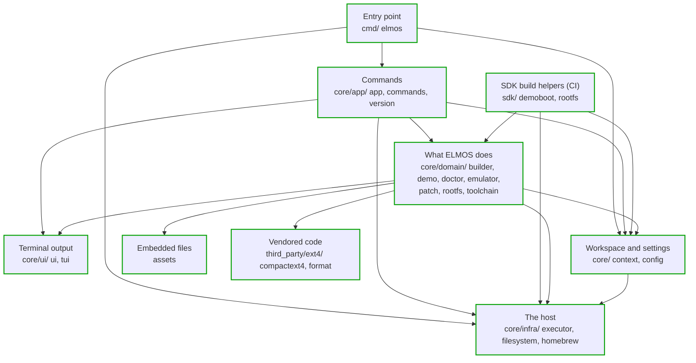
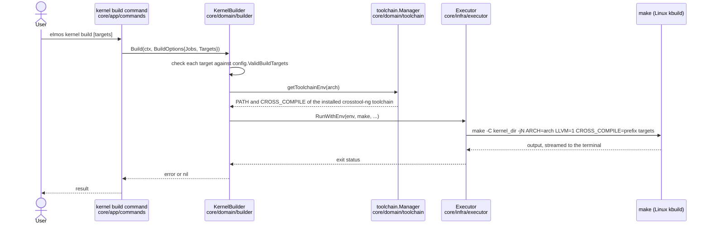
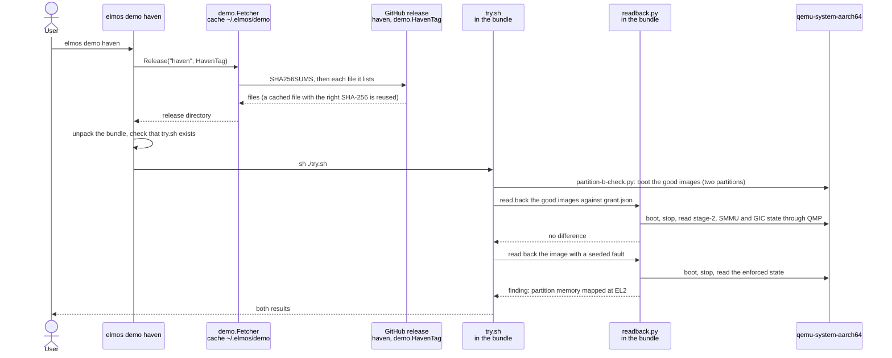
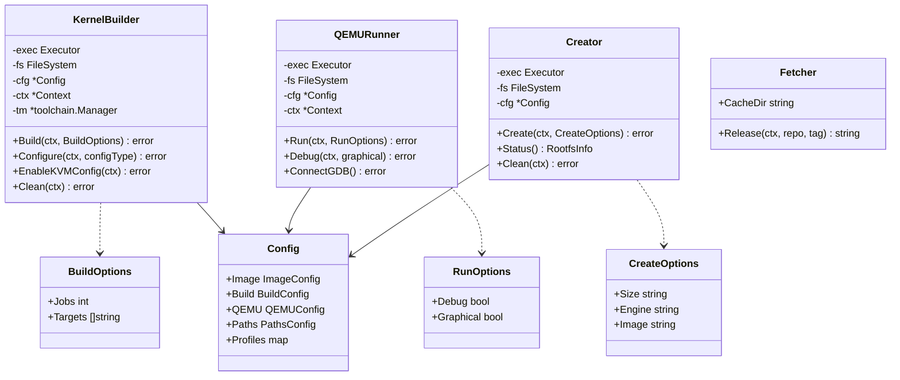
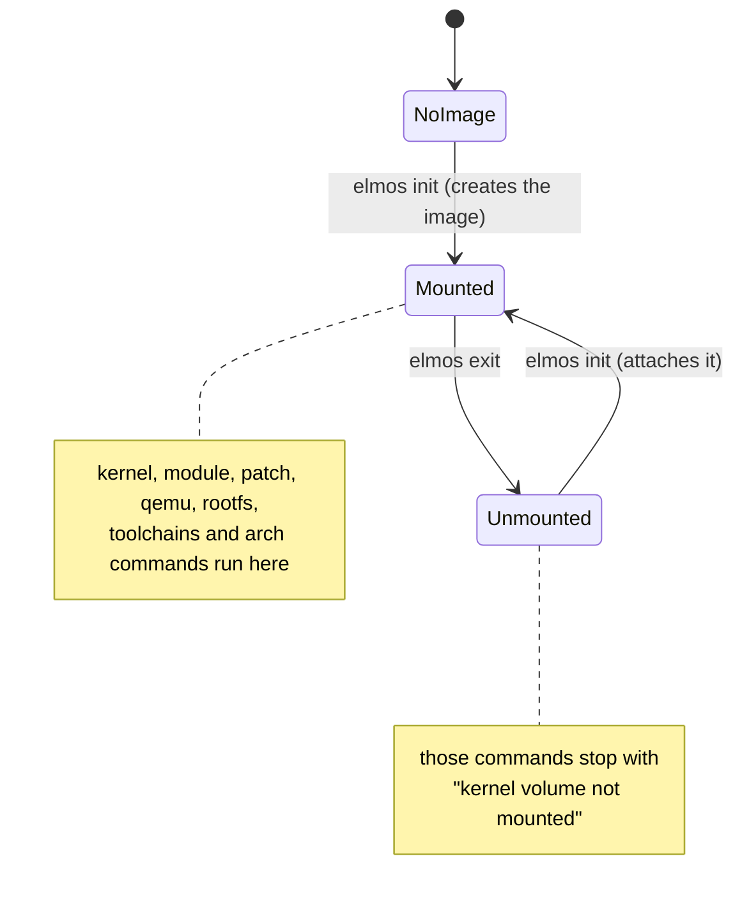
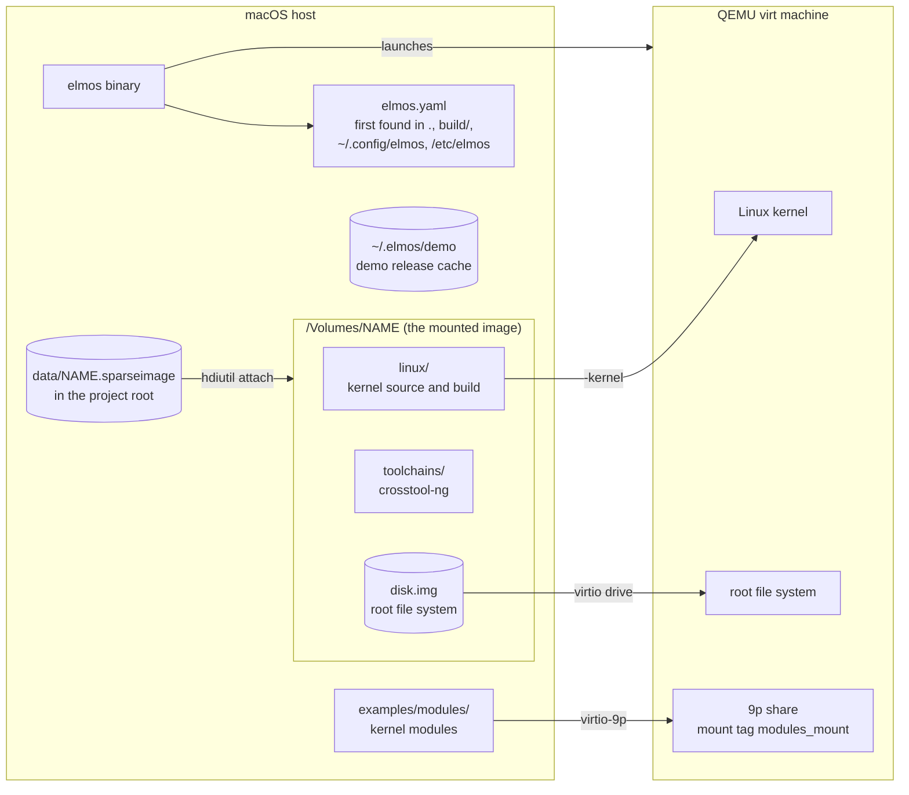

# Architecture Diagrams

Diagrams of ELMOS as the code stands, drawn as Mermaid text: GitHub draws
them here and the [documentation site](https://docs-haven.vercel.app/elmos/)
draws the same text in its own colours. Everything shown is in the code and
runs in ELMOS's CI. The evidence key shared with HAVEN and KDAL is on the
site's [Reading the diagrams](https://docs-haven.vercel.app/start/diagrams/)
page.

The component diagram is checked against the code:
`go test ./docs/developer/` fails when a package or an import between the
groups below is missing from it, or when it shows one the code does not
have.

---

## Components

Package groups and the imports between them. An arrow means "imports".

`core/domain/toolchain` imports `core/ui` (its manager holds a printer),
the one place where the domain reaches the terminal layer.

---

## Kernel build

`elmos kernel build` (`core/app/commands/kernel.go`,
`core/domain/builder/kernel.go`, `core/domain/builder/env.go`).

---

## The HAVEN demo

`elmos demo haven` (`core/app/commands/demo.go`, `core/domain/demo/demo.go`)
fetches HAVEN's try bundle and runs its `try.sh`, described in HAVEN's
[`scripts/release/try/README.md`](https://github.com/NguyenTrongPhuc552003/haven/blob/main/scripts/release/try/README.md).

---

## Main types

The domain types the commands use (`core/domain/*`, `core/config/types.go`).
Fields are unexported unless marked `+`.

`Creator.Create` uses an OCI image by default (`alpine:3`); debootstrap is
the other engine.

---

## Workspace states

The case-sensitive volume that holds the kernel source, root file system and
toolchains (`core/app/commands/init.go`, `core/context/context.go`).

`elmos init [name] [size]` creates a sparse, case-sensitive APFS image
(`hdiutil create`) if there is none, then attaches it; `elmos exit [--force]`
detaches it. `demo`, `doctor`, `status` and `version` work in any state.

---

## Deployment

Where things live on the Mac, and what QEMU gets (`core/config/loader.go`,
`core/domain/emulator/qemu.go`). Paths are the defaults; `elmos.yaml`
can change them. The first `elmos.yaml` found is used.

